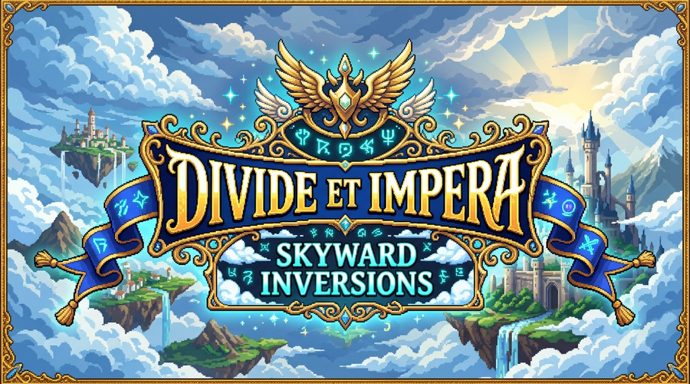
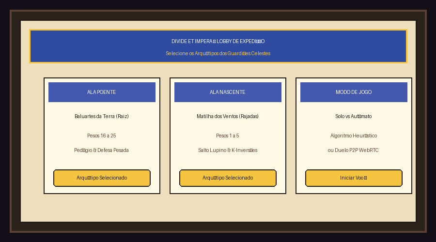
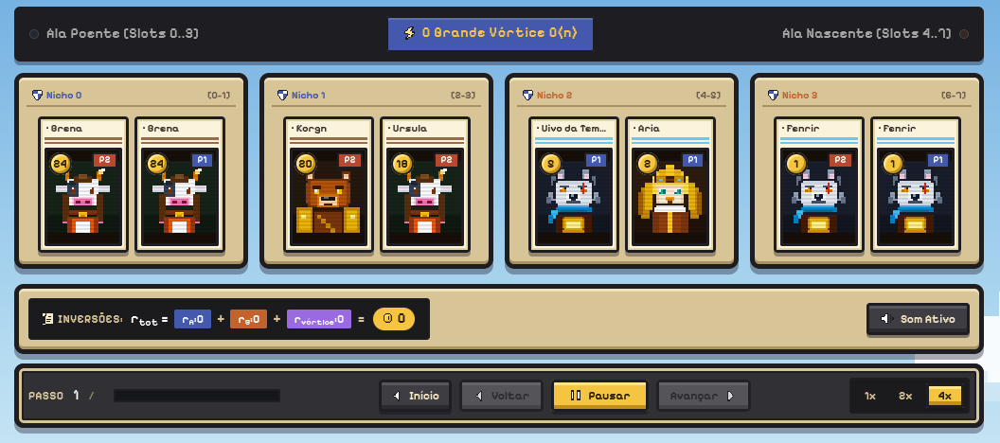
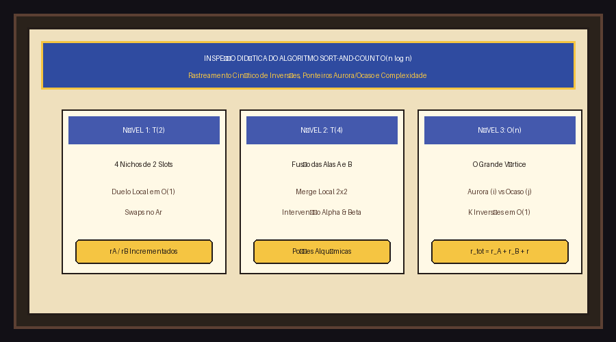

<p align="center">
  
</p>

<p align="center">
  <a href="https://projeto-de-algoritmos-2026.github.io/G6_Dividir_e_Conquistar_PA-26.2/" target="_blank">
    
  </a>
  &nbsp;&nbsp;
  <a href="https://youtu.be/DyDZmRH91o4" target="_blank">
    
  </a>
</p>

# Divide et Impera: Skyward Inversions - Grupo 6

Número da Lista: 4<br>
Conteúdo da Disciplina: Dividir e Conquistar (D&C)<br>

## Alunos

| Matrícula | Aluno |
| :---: | :--- |
| 24/1011027 | Eduardo Lôbo Moreira |
| 24/1041302 | Hugo Freitas Silva |

## Sobre

O **Divide et Impera: Skyward Inversions** é um jogo tático de cartas 1v1 desenvolvido para a disciplina de Projeto de Algoritmos da Universidade de Brasília (UnB). Ambientado em um universo pastoral celeste inspirado na estética e na identidade visual de *Cloud Meadow*, o projeto transforma a mecânica do paradigma de **Dividir e Conquistar** no motor dinâmico e visual dos combates: o cálculo e a contagem de inversões via **Sort-and-Count (Merge-and-Count)** em tempo ótimo $\mathcal{O}(n \log n)$.

- **Acesso Online (GitHub Pages):** [https://projeto-de-algoritmos-2026.github.io/G6_Dividir_e_Conquistar_PA-26.2/](https://projeto-de-algoritmos-2026.github.io/G6_Dividir_e_Conquistar_PA-26.2/)
- **Vídeo de Apresentação:** [https://youtu.be/DyDZmRH91o4](https://youtu.be/DyDZmRH91o4)

### Como funciona

- **Modelagem do Problema (Counting Inversions):** Dada uma sequência de $n = 8$ criaturas posicionadas alternadamente nas ilhas flutuantes do arquipélago, uma inversão ocorre sempre que um par de posições $(i, j)$ satisfaz $i < j$ com peso $A[i] > A[j]$. Em vez de avaliar exaustivamente todos os pares em $\mathcal{O}(n^2)$, o jogo divide o arquipélago recursivamente em estratos balanceados.
- **Estrutura Recursiva do Arquipélago:**
  - **Fase Dividir (Base da Recursão):** O arquipélago de 8 slots parte-se em duas metades: **Ala Poente** ($A[0..3]$) e **Ala Nascente** ($A[4..7]$). Em seguida, subdivide-se em **4 Nichos** elementares de 2 slots ($T(2)$).
  - **Duelos de Nicho $T(2)$:** Cada par de slots adjacentes compara seus pesos em $\mathcal{O}(1)$. Se $A[\text{esq}] > A[\text{dir}]$, ocorre um *swap* dinâmico e $+1$ inversão local é registrada em $r_A$ ou $r_B$.
  - **Fusão das Alas (Nível 2):** Os nichos ordenados fundem-se em pares formando a Ala Poente (sub-vetores $0..1$ e $2..3$) e a Ala Nascente (sub-vetores $4..5$ e $6..7$), acumulando as inversões locais $r_A$ e $r_B$.
  - **O Grande Vórtice (Nível 3 - Merge Final em $\mathcal{O}(n)$):** O **Ponteiro da Aurora** ($i$ no topo de $A$) confronta o **Ponteiro do Ocaso** ($j$ no topo de $B$). Sempre que a carta de $B$ é estritamente mais leve que a carta de $A$ ($A[j] < A[i]$), ela ultrapassa de uma só vez **todas as $k$ cartas restantes** da Ala Poente, somando $+k$ inversões cruzadas ($r_{\text{vórtice}}$) em $\mathcal{O}(1)$.
- **Equação Viva do Dano:** O total de atrito e dano no encerramento da rodada obedece com rigor matemático a identidade de Dividir e Conquistar:
  $$\mathbf{r}_{\text{total}} = \mathbf{r}_A + \mathbf{r}_B + \mathbf{r}_{\text{vórtice}}$$
- **Janelas de Intervenção Tática & Fórmulas Alquímicas:** O fluxo do algoritmo faz pausas táticas na **Janela Alpha** (após a ordenação dos nichos) e na **Janela Beta** (após o merge das alas). Nelas, os comandantes usam poções alquímicas preparadas para alterar pesos numéricos ou permutar criaturas vizinhas, manipulando as inversões antes dos merges finais.
- **Motor Algorítmico Central:** Toda a simulação e contagem passo a passo estão implementadas com suporte a retomada em [`src/lib/engine/inversions.ts`](https://github.com/projeto-de-algoritmos-2026/G6_Dividir_e_Conquistar_PA-26.2/blob/main/src/lib/engine/inversions.ts), complementadas pela IA com tomada de decisão heurística em [`src/lib/engine/bot.ts`](https://github.com/projeto-de-algoritmos-2026/G6_Dividir_e_Conquistar_PA-26.2/blob/main/src/lib/engine/bot.ts).
- **Modos de Jogo:**
  - **Solo vs Autômato:** Duelo contra a IA que avalia permutações ótimas e uso de fórmulas táticas.
  - **Duelo P2P (WebRTC):** Partidas em tempo real entre dois navegadores via PeerJS sem necessidade de servidor backend intermediário.

## Screenshots

### Tela Inicial (Lobby de Preparação)



### Partida em Andamento (Bolsa de Fórmulas e Semeadura)



### Inspeção Algorítmica Cinética & Métricas D&C



## Instalação

**Linguagem:** TypeScript<br>
**Framework:** Astro 5 + Svelte 5 (Runes)<br>

### Pré-requisitos

- **Node.js** (versão 18 ou superior)
- **npm**

### Comandos de Execução

1. Clone o repositório:

```bash
git clone https://github.com/projeto-de-algoritmos-2026/G6_Dividir_e_Conquistar_PA-26.2.git
cd G6_Dividir_e_Conquistar_PA-26.2
```

2. Instale as dependências do projeto:

```bash
npm install
```

3. Inicie o servidor de desenvolvimento:

```bash
npm run dev
```

O jogo estará disponível no navegador em: `http://localhost:4321/`

## Uso

1. Na tela inicial do **Lobby de Expedição**, selecione o arquétipo do seu deck (**Rajadas**, **Raiz**, **Zéfiro** ou **Éter**) e escolha o modo **Solo** ou **Conexão P2P**.
2. **Fase de Semeadura:**
   - Selecione uma criatura no seu grimório inferior.
   - Clique em uma ilha flutuante disponível no calendário superior para posicioná-la.
   - Acompanhe em sua **Bolsa de Fórmulas** as poções alquímicas preparadas para a rodada.
3. **Execução Cinética do Algoritmo:**
   - Utilize a barra de controle da linha do tempo para **Avançar**, **Voltar**, **Pausar** ou alterar a velocidade de reprodução (**1x, 2x, 4x**).
   - Ao atingir as **Janelas de Intervenção Alpha e Beta**, utilize suas fórmulas para alterar pesos ou forçar permutações estratégicas.
   - Observe na placa superior a resolução da fórmula viva: $r_{\text{tot}} = r_A + r_B + r_{\text{vórtice}}$.

## Outros

### Link do Vídeo de Apresentação

- [https://youtu.be/DyDZmRH91o4](https://youtu.be/DyDZmRH91o4)

### Comandos Adicionais

- Verificação matemática formal do motor D&C vs força bruta $\mathcal{O}(n^2)$:

```bash
npx tsx scripts/verify-engine.ts
```

- Geração do bundle de produção:

```bash
npm run build
```

- Pré-visualização da build local:

```bash
npm run preview
```

### Tecnologias e Recursos

- **Paradigma Central:** Dividir e Conquistar — Algoritmo de Ordenação e Contagem de Inversões (*Merge Sort and Count Inversions*) em $\mathcal{O}(n \log n)$.
- **Identidade Visual:** Direção de arte fiel a *Cloud Meadow* (paleta de pergaminho, latão escovado, botões táteis skeuomórficos, estandartes rúnicos e fontes pixel-art).
- **Áudio Adaptativo:** Web Audio API sintetizada com assinaturas sonoras para divisões, swaps mecânicos, passagens serenas e fanfarras de vitória.
- **Rede P2P:** Protocolo WebRTC bidirecional para partidas 1v1 cliente-a-cliente nativas no navegador.

## Créditos

- **Desenvolvedores:**
  - Eduardo Lôbo Moreira (24/1011027)
  - Hugo Freitas Silva (24/1041302)
- **Disciplina:** Projeto de Algoritmos (PA 26.2) — Módulo de Dividir e Conquistar (Universidade de Brasília - UnB)
- **Inspiração Visual e Artística:**
  - Direção de interface, layout skeuomórfico de pergaminhos e banners celestes inspirados em *Cloud Meadow* (Team Nimbus / S-Purple).
  - Componentes e ícones em pixel-art desenhados em matriz 10×10 autoral.
